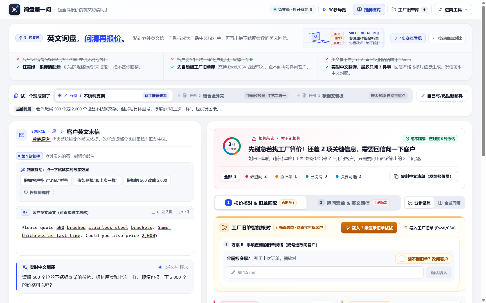
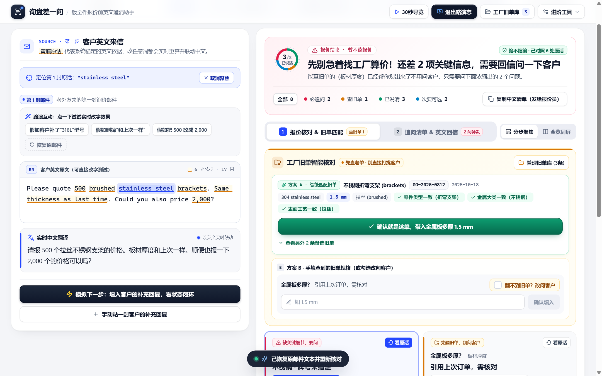
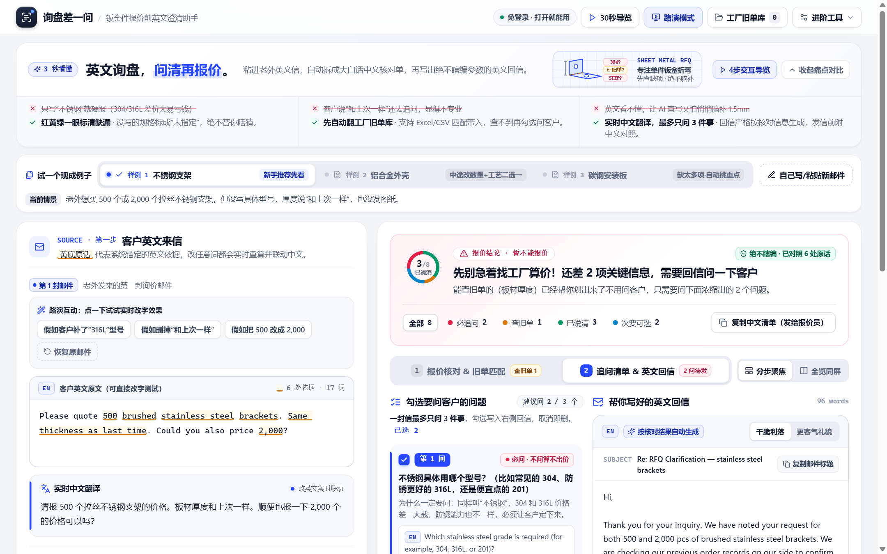
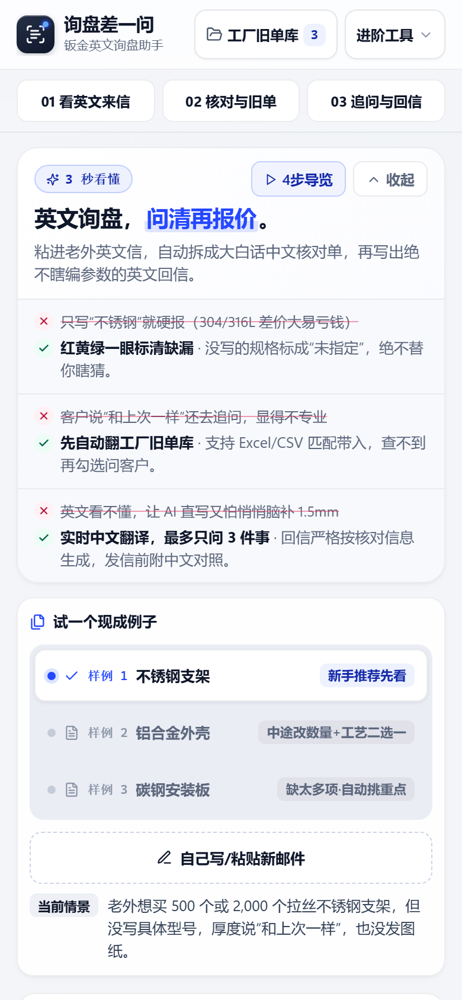

# 询盘差一问（Sheet Metal RFQ Clarification Assistant）

> **面向中小型钣金厂外贸业务员的报价前英文询盘澄清与防幻觉回信助手**  
> **知乎黑客松 S3 参赛作品 · 免注册免登录 · 打开即用 · 零幻觉强锚定**



## 1. 为什么做「询盘差一问」？

中小制造企业在接海外非标钣金英文询盘（RFQ）时，进入 CAD 工程审图算价之前常陷入三难困境：
1. **漏问盲报导致退单或亏损**：`stainless steel` 没写 `304`/`316L`、`6061-T6` 小 R 角折弯开裂风险、`"Same thickness as last time"` 当新单漏查，直接交给工程往往被打回或报亏。
2. **模板群问拉低买家回复率**：一次性追问十几个问题，甚至重复索要客户明明写明 `"Drawing to follow"` 或引用旧单的参数。
3. **通用 AI 代写容易“擅自脑补”**：直接让通用大模型总结询盘或写回信，极易擅自把 `stainless steel` 补成 `304` 或编造板厚与公差承诺。

本工具专注守好**“报价前最后一公里”**：把客户英文来信拆成 **「已说清 / 先查旧单 / 客户待发 / 必追问」**，按 `P0 > P1 > P2` 严格收敛至 **最多 3 个最影响报价的问题**，并生成**严格基于已核实原话**的可编辑纯英文回信（附逐段中文对照）。

---

## 2. 核心能力一览

| 模块 | 核心体验与能力边界 |
| :--- | :--- |
| **双舞台双语实时对照** | 左侧锁定英文原信 + 实时中文翻译 + 「一键改字试测」实验条 + 最多 3 轮往来时间轴；右侧常驻「报价裁决仪表盘」与聚焦视图切换。 |
| **8 项钣金参数核对 & 双向原话溯源** | 覆盖材料/牌号、板材厚度、分档数量、工程图纸、表面处理、公差与二次加工、零件类型、交期条款；点击「看原话」高亮左侧英文原句，光标点击原句反向点亮右侧参数卡。 |
| **纯本地工厂旧单库智能匹配** | 纯浏览器本地解析工厂 `.xlsx` / `.csv` 历史订单（含 UTF-8/GBK 兼容与模板下载，数据不出本地），自动匹配推荐旧单一键带入，支持手填与“翻不到旧单改问客户”开关。 |
| **防幻觉与 ≤3 问纯英文回信** | 强制经过 `groundingValidator` 逐字原句校验，严禁编造 `304` / `1.5 mm`；自动生成带已核实规格 `Subject:` 的纯英文回信 + 双语气切换 + 逐段中文对照。 |
| **30 秒四步导览 & 路演模式** | 顶栏提供「30秒导览」聚光灯指引与「路演模式（快捷键 `P`）」，适配大屏投影及移动端 `390px` 自适应试玩。 |

### 界面实景展示

| 工厂旧单智能核对 | ≤3 问收敛与纯英文回信 | 手机端自适应布局 |
| :---: | :---: | :---: |
|  |  |  |

---

## 3. 技术架构与防幻觉机制

```text
英文多轮邮件 (EmailRound[])
   │
   ├─[默认 · 零网络依赖毫秒级本地引擎] localExtractor.ts (数字掩码隔离 + 上下文传递)
   └─[可选 · 外部大模型模式]           llmExtractor.ts (/api/extract 或 BYOK)
                                            │
                                            ▼
                                  groundingValidator.ts (逐字原句引文强制校验，拦截无出处补值)
   │
   ▼
merger.ts (多轮状态合并 · 增量加档/改单识别 · “same as last time”分流)
   │
   ▼
sheetMetalRules.ts (SGCC预镀锌/16 Gauge换算/铜黄铜/6061-T6折弯预警 + P0>P1>P2 截断 ≤3 问)
   │
   ▼
replyGenerator.ts + localTranslator.ts (纯英文回信 + Subject 派生 + 实时中文翻译)
```

---

## 4. 评测跑分与自动化验证

内置 **「10例实测」实时评测器**（[`src/engine/evaluator.ts`](src/engine/evaluator.ts) / [`src/data/benchmarkCases.ts`](src/data/benchmarkCases.ts)）与 **22 项 Vitest 端到端测试**（[`src/__tests__/pipeline.test.ts`](src/__tests__/pipeline.test.ts)）：

- **单件钣金目标样例通过率**：**9 / 9（100%）**
- **漏问关键项 / 重复追问 / 擅自补值幻觉**：**0 / 0 / 0**
- **诚实已知边界（Case 10）**：当单封邮件混写两款不同零件 BOM（如同时包含 `brackets` 与 `covers`）时，系统会触发多零件边界提示；单件模型合并两套规格作为已知边界明确记录，规划在 V1.1 演进为多子单拆卡。
- **自动化单测**：`npm test` **22 / 22 全部通过**；`npm run build` **0 错误**。

> **刻意边界声明**：首版明确不做 CAD/PDF 自动识图、自动算价与邮件自动代发，将最终工艺核价与发信决定权保留给工程与业务员。

---

## 5. 快速运行、测试与公网部署

### 本地运行与测试（Node.js 20+）

```bash
npm install
npm test          # 运行 22 项自动化单元测试
npm run build     # TypeScript 类型检查 + 产出 dist/ 生产包
npm run dev       # 启动 Vite 开发服务器（含 /api/extract 本地转发）
npm run start     # 直接用内置零依赖静态服务 preview-server.mjs 预览 dist/
```

### 一键部署公网体验版（Vercel / Netlify）

项目内置 [`vercel.json`](vercel.json)、[`netlify.toml`](netlify.toml) 与 [`api/extract.ts`](api/extract.ts)：
- **零配置免登录上线**：不设置任何环境变量即可直接作为纯静态 Web 应用部署至 **Vercel / Netlify / Cloudflare Pages**，内建本地确定性解析引擎完全可用。
- **可选接入服务端大模型**：如需开启外部模型增强，可在部署平台配置环境变量 `LLM_API_KEY`、`LLM_BASE_URL`、`LLM_MODEL`（参考 [`.env.example`](.env.example)）。

---

## 6. 仓库目录索引与文档

- [`docs/产品说明计划书.md`](docs/产品说明计划书.md) — 知乎黑客松 S3 产品说明计划书（完整覆盖痛点、功能、架构评测、知乎社区结合、价值与规划）
- [`HANDOVER.md`](HANDOVER.md) — 工程模块索引与演示脚本
- [`src/engine/`](src/engine/) — 抽取、逐字防幻觉校验、多轮合并、钣金规则、回信生成、翻译、旧单匹配与 10 例评测核心代码
- [`src/data/`](src/data/) — 3 套两轮演示样例、10 封评测案例、8 字段规则手册与演示工厂旧单
- [`src/components/`](src/components/) — 双舞台工作台 UI 组件
- [`api/extract.ts`](api/extract.ts) — 可选 Vercel 无服务器转发接口
- [`scripts/preview-server.mjs`](scripts/preview-server.mjs) — 一键启动脚本使用的零依赖本地 HTTP 服务

## License

[MIT](LICENSE)
