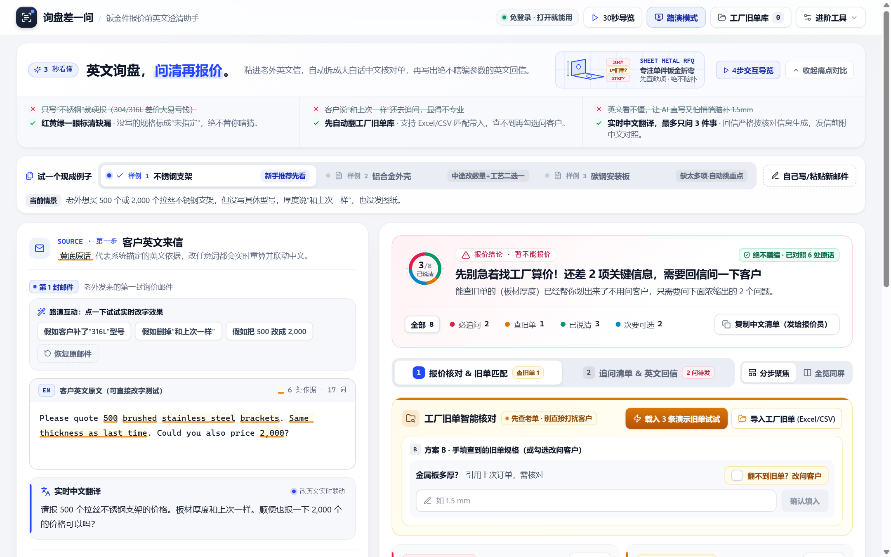
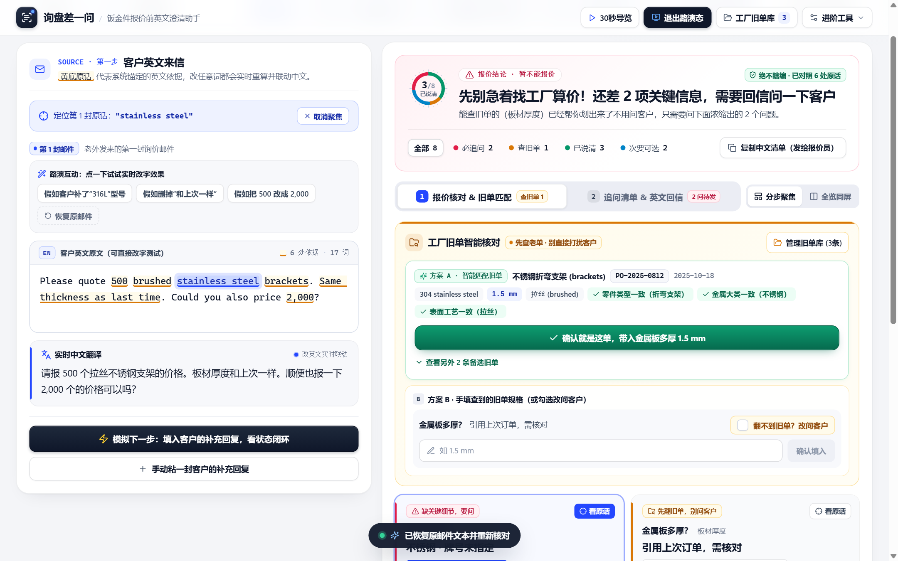
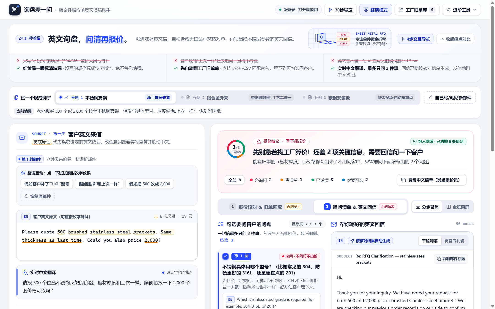
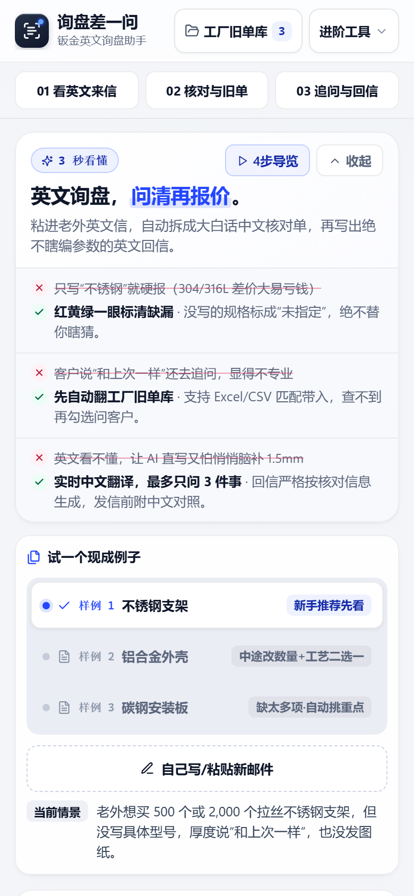

# 《询盘差一问》产品说明计划书

> **副标题**：面向中小型钣金外贸业务员的报价前英文询盘澄清与防幻觉回信助手  
> **参赛赛事**：知乎黑客松 S3（Zhihu Hackathon Season 3）  
> **提交形态**：可运行在线 Web 应用 ＋ 产品说明计划书 ＋ 开源 Git 代码仓库  

---

## 项目名片与快速体验说明

| 项目维度 | 说明 |
| :--- | :--- |
| **作品名称** | **询盘差一问**（Sheet Metal RFQ Pre-Quoting Clarification Assistant） |
| **在线体验地址** | **https://xunpan-cha-yiwen.netlify.app**（已部署上线，免登录直达） |
| **登录与账号要求** | **完全免注册、免登录、零配置**。评委打开网页即可完整操作全部功能，无需测试账号。 |
| **默认运行机制** | 内置纯浏览器本地确定性抽取、中英实时互译与工艺规则引擎（无网络延迟）；同时提供可选的 OpenAI 兼容服务端转发接口（`/api/extract`）或浏览器会话密钥（BYOK）接入。 |
| **代码与质量验证** | React 19.1 + TypeScript 5.8 + Vite 7 + Tailwind CSS v4；**22 项 Vitest 自动化单元测试全通过**；内置 **10 封扩展样例实时评测套件（9/9 单件目标通过，0 漏问，0 重复追问，0 幻觉补值）**。 |

### 评委 90 秒核心体验路线
1. **打开即见默认样例 1（不锈钢支架首轮）**：系统自动标出「500 / 2,000 两档分档询价」「拉丝表面」「缺不锈钢牌号（不擅自脑补成 304）」「板厚引用旧单（转入内部先核对，不直接打扰客户）」，并将追问严格收敛至 **2 问（牌号、图纸）**。
2. **体验工厂旧单智能核对**：在黄底「工厂旧单智能核对」卡片中点击 **「载入 3 条演示旧单试试」**（或导入工厂 `.xlsx`/`.csv`），系统匹配出 `PO-2025-0812`，点击 **「确认就是这单，带入金属板多厚 1.5 mm」**，板厚立即转绿为已说清状态，底部英文回信自动附带按 `1.5 mm` 核价的请客户复核说明。
3. **点击原话溯源 & 一键改字试测**：点击右侧任意参数卡片的 **「看原话」** 高亮左侧英文原句；点击左侧实验条上的 **「假如客户补了“316L”型号」**、**「假如删掉“和上次一样”」**、**「假如把 500 改成 2,000」** 或直接改写英文词句，感受毫秒级双语重算与底部实时变更提示。
4. **点击「模拟下一步：填入客户的补充回复，看状态闭环」**：补齐 `304 stainless, 1.5 mm` 与 `Drawing to follow`，追问列表自动清零且不重复催图，进入 **「静待图纸即可报价」** 闭环态。
5. **体验大屏路演与量化评测**：按键盘 `P`（或点右上角 **「路演模式」**）进入大屏聚焦视图，也可点击 **「30秒导览」** 走完 4 步聚光灯流程；点击 **「进阶工具 → 10例实测」** 可查看并实时重跑 10 封询盘基准测试。

---

## 一、解决什么问题：制造业出海一线的「报价前断层」

中国中小钣金加工厂与机械零部件外贸企业在接海外非标定制询盘（RFQ, Request for Quotation）时，从**「收到客户第一封英文邮件」**到**「交给报价工程师审图算价」**之间，长期存在一个高频却常被忽视的三难困境：

### 1.1 现场业务的三难痛点

| 痛点类型 | 真实发生场景 | 造成的业务损失 |
| :--- | :--- | :--- |
| **① 漏问盲报 → 退单或亏损** | 业务员不懂材料成型与工艺细节，把只写了 `"stainless steel"` 的邮件直接转给工程报价，未确认 `304` 还是 `316L` / `201`（不同牌号料价差异显著）；未识别 `6061-T6` 硬铝小 R 角折弯开裂风险；把 `"Same thickness as last time"` 当成常规新单遗漏核查；未区分 `SGCC` 预镀锌板与普通冷轧钢 `SPCC`。 | 工程反复退单打回、拉长报价周期；若按低成本牌号盲报被客户锁定订单，工厂将直接亏损。 |
| **② 模板群问 → 拉低回复率** | 新人害怕漏项，每次都发长达十几条的英文模板问卷：客户明明写过 `"500 ... also price 2,000"`、说过 `"Drawing to follow"` 或引用了历史旧单，回信仍在重复追问、催图甚至索要冗余参数。 | 海外买家体验极差、认为我方不专业甚至未认真读信，关键首轮回复率显著下降。 |
| **③ 通用 AI 代写 → 幻觉违约风险** | 直接用通用聊天大模型总结询盘或代写回信时，模型倾向于“把不完整的请求补完整”——擅自将 `"stainless steel"` 补写为常见的 `SUS304`，或把 `"tight tolerance"` 默认成 `±0.1 mm`，甚至在回信里混入原文从未确认过的厚度、交期或承诺。 | 一旦客户回复 `Confirmed` 按此生产，未约定清晰的规格偏差将演变为商业赔付纠纷。 |

### 1.2 核心定位与产品设计原则
《询盘差一问》刻意不做大而全的 ERP 或全自动算价工具，而是精准切入**「报价前最后一公里澄清（Pre-Quoting Clarification）」**：
- **防幻觉优先（Grounded Only）**：原文没写具体牌号或板厚，系统宁可标黄/标红追问，也**绝不擅自脑补**。
- **信息分层分流（Triaging）**：不是所有缺失都要发邮件问客户——引用旧单的先内部核对（`先查旧单`），客户承诺补发的不再催问（`客户待发`），真正影响报价的才进入追问（`必追问`）。
- **克制追问（Cap ≤ 3）**：一封澄清邮件只按 **`P0 影响报价与成型 > P1 工艺与公差 > P2 交期与条款`** 挑最关键的 **最多 3 个问题** 发问，保证海外买家读得进去、愿意回信。
- **零英文与工艺门槛**：每一封英文来信、每一个行业参数说明、以及发信前的英文回信草稿，全程配齐大白话中文对照与原话溯源。

---

## 二、核心功能与交互设计

产品围绕真实外贸业务流与会场大屏演示场景，重构为**「双舞台双语聚焦工作台」**。



### 2.1 双舞台双语舞台与多轮追答时间轴（左侧 42% 锁定源）
- **3 套内置高频实战样例 + 自由粘贴新建**：预置「不锈钢支架（含分档+旧单引用）」「铝合金外壳（含中途改单 300→800+工艺二选一）」「碳钢安装板（6 项缺失自动收敛前 3 问）」，同时支持一键清空粘贴任意真实客户英文邮件。
- **「一键改字试测」实验条**：每套样例均配备一键改字测试胶囊（例如样例 1 的「假如客户补了“316L”型号」「假如删掉“和上次一样”」「假如把 500 改成 2,000」），点击即刻改动原文并观察右侧结论实时重算。
- **实时中文翻译（零英文门槛）**：每封英文邮件下方同步生成流畅准确的中文工程译文；改写英文中的材质、板厚、分档或贸易条款词句，中文翻译毫秒级联动更新。
- **多轮邮件合并追踪**：支持「一键填入第 2 轮客户补充回复」及手动新增/删除最多 3 轮往来邮件，跨轮保留第一轮已核实条件，精准识别「增量加档（如 `C260, also price 1,500.`）」「中途改单覆盖（如 `actually please change it to 800 pcs`）」与「待发图纸更新」。

### 2.2 报价裁决仪表盘与 8 项钣金参数核对（右侧剧场）
- **Verdict Hero 报价裁决仪表盘**：顶部精工环形进度表搭配语义状态总览（红/琥珀/蓝/绿四态），一眼看清**是否能报、已核实几项、需先查旧单几项、必问几项**，并支持按状态一键筛选下方卡片，同时提供「复制中文清单」一键转交给报价工程组。
- **8 项核心钣金字段全覆盖**：围绕报价核心要素，实时输出每项的状态标签、通俗中文解释、实际提取值与出处徽章：
  1. **用什么材料？（金属种类与型号）**
  2. **金属板多厚？（板材厚度）**
  3. **要买多少个？（采购数量）**
  4. **发设计图了吗？（图纸 / 3D 文件）**
  5. **表面怎么做？（拉丝 / 喷粉 / 防锈）**
  6. **精度与特殊加工（公差 / 螺母 / 焊接）**
  7. **做什么零件？（零件名称）**
  8. **交货时间与方式（交期 / 运费条款）**
- **双向跨栏原话溯源**：点击右侧任意卡片的「看原话」，左侧对应英文句子立即蓝底高亮并聚焦；将光标点进左侧英文句子时，右侧对应的参数卡片也会同步高亮联动，强化“句句有出处”。

### 2.3 纯本地工厂旧单库智能匹配与人工兜底


- **数据不出浏览器**：点击顶栏「工厂旧单库」可导入工厂自己的 `.xlsx` 或 `.csv` 历史订单表（内置 UTF-8/GBK 编码兼容解析器与标准 CSV 模板下载，并预载 3 条典型演示旧单），全部解析与存储均在本地 `localStorage` 完成，保护工厂报价与客户隐私。
- **方案 A / 方案 B 核对闭环**：当客户提到 `"Same thickness as last time"` 或 `"repeat order, same as last time"` 时，系统自动按**历史单号、零件名称、材料大类与表面工艺**对旧单库打分推荐：
  - **方案 A（一键确认带入）**：高亮显示匹配到的最佳历史订单（如 `PO-2025-0812` / `1.5 mm`）及备选旧单切换；点击确认后，规格带入需求卡并在回信中优雅写明“按上次订单规格核价，如有变更请提示”。
  - **方案 B（手填与查不到兜底）**：支持手填内部翻查到的具体厚度/牌号/图号；若确实查无旧单，勾选「翻不到旧单？改问客户」，该项立即进入右侧追问与回信草稿中。

### 2.4 最多 3 问收敛与信纸级纯英文回信生成器


- **严格 `≤ 3 问` 优先级裁剪**：待确认问题统一按 `P0 > P1 > P2` 排序，超出 3 项自动折入「为什么没问其他事？」折叠解释栏（例如：“优先锁住材料/板厚/数量，贸易条款与次要工艺放在下一轮确认，避免一次连问十几个问题吓跑客户”）。
- **绝不瞎编 + 纯英文净化防线**：自动生成带已核实参数的 `Subject:` 邮件主题行，支持「干脆利落 / 更客气礼貌」两种语气切换与人工手动编辑锁定；回信正文严格过滤任何未核实的猜测词与中文字符。
- **逐段中文对照**：在英文回信下方实时展示中文含义翻译，让完全不懂英文的工厂接单员也能自信核对无误后再复制发送。

### 2.5 路演与全端交互体验细节


- **实时变更动态浮标（Live Delta Pill）**：改字、带入旧单或填入第 2 轮回复引起状态变化时，屏幕下方柔滑浮现摘要提示（例如 `已实时重算 · 用什么材料已确认（316L stainless steel） · 已说清 2/8 → 3/8 · 建议追问 2 → 1 个`），演示节奏清晰抓人。
- **「30 秒导览」与「路演模式（快捷键 P）」**：内置 4 步交互式聚光灯导览一键走完完整闭环；开启「路演模式」自动收起教学横幅并适度放大投影字号；同时对 `390px` 移动端做了垂直流式适配，评审扫码即用。

---

## 三、技术实现与防幻觉评测验证

### 3.1 系统整体处理流水线

```text
多轮客户英文邮件 EmailRound[]
   │
   ├─[默认 · 本地零配置毫秒响应] localExtractor.ts (逐轮传递 priorContext 上下文)
   └─[可选 · 大模型增强模式]     llmExtractor.ts (/api/extract 或 BYOK) ──▶ groundingValidator.ts (逐字原句引文强校验)
   │
   ▼
merger.ts (第 1 轮 → 第 N 轮状态合并 · 增量加档/改单覆盖/“same as last time”分流 · 轮次来源追踪)
   │
   ▼
sheetMetalRules.ts (结合工厂旧单核对态 & 查无旧单兜底开关 → P0 > P1 > P2 裁决与 ≤3 问截断)
   │
   ▼
replyGenerator.ts + localTranslator.ts (已核实摘要 Subject/Ack + 勾选追问 + 旧单复核句 + 逐段中文译文)
```

### 3.2 关键工程技术亮点

1. **数字冲突掩码隔离算法（`localExtractor.ts`）**：
   外贸英文邮件里数字极易混淆（例如 `304` 是牌号、`1.5 mm` 是板厚、`100 x 200 mm` 是尺寸、`RAL 9005` 是色号、`2 weeks` 是交期）。引擎在抽取采购数量前，会按确定顺序**先识别并掩码（mask）订单编号、长宽尺寸、公差、毫米/英寸/Gauge 厚度、RAL 色号、金属牌号与交期时长**，再对剩余文本扫描数量与分档结构（如 `500 ... also price 2,000` 或 `100, 500, and 2,000 pcs`），彻底消除“把板材牌号或公差误当成采购件数”的常见解析 bug。
2. **模型输出「逐字防幻觉拦截墙」（`groundingValidator.ts`）**：
   即使切换至外部 LLM 模式（`/api/extract` 无服务器函数或会话内自带 API Key），前端也会强制执行 `validateAndGroundLlmOutput()`：**要求大模型输出的每一项字段（牌号、厚度、数量、交期、公差等）必须附带当前轮邮件的精确原文子串引文（`quotes`），且抽取数值必须真实存在于引文之中**。任何没有原文精确锚定依据的猜测值（如擅自把 `stainless` 补成 `304` 或编造 `1.5 mm`）都会被校验层直接剔除，并在页面审计条中记录“已拦截未见于原文的补值次数”。
3. **跨轮语义合并与材料成型工艺专业规则（`merger.ts` & `sheetMetalRules.ts`）**：
   - **增量加档 vs 改单区分**：对比 `"also price 1,500"`（跨轮新增分档，与首轮 `300` 合并为两档 `300 / 1,500`）与 `"Originally planned 300 ... actually please change it to 800"`（疑似改单确认）。
   - **材料成型行业深度判断**：
     - 识别 `SGCC` / `SECC` / `DX51D` 属于预镀锌基板，**不误触发**“普通碳钢未提表面防锈必问”规则；
     - 识别美标 `16 Gauge` 规格，在保留原文的同时按具体材质给出精准毫米工程参考（不锈钢 ≈ `1.59 mm`、碳钢 ≈ `1.52 mm`、铝 ≈ `1.29 mm`）；
     - 支持紫铜/黄铜（`C110`/`T2` vs `C260`/`H62`）独立牌号判断分支；
     - 识别 `6061-T6` 硬铝折弯场景时，主动输出“小折弯半径易裂纹，需工程确认 R 角与纹理方向”提醒。
4. **回信纯英文防泄漏机制**：
   针对模板拼接可能带入中文状态标签的风险，回信生成器仅引用结构化英文原话引文或英文枚举描述，并配套永久单元测试断言英文回信正文绝不出现任何汉字或重复嵌套翻译标记。

### 3.3 10 封扩展询盘实时评测与 22 项单测结果

产品右上角内置可由评委当场重跑的 **「10例实测」评测器（`evaluator.ts` + `benchmarkCases.ts`）**，覆盖单轮缺项、两轮闭环、中途改单+工艺二选一、全单引用历史订单、3 档分档 + Gauge 换算、SGCC 预镀锌、黄铜跨轮加档、6061-T6 折弯风险及多零件 BOM 已知边界案例：

| 评测指标 | 实测结果 | 说明 |
| :--- | :--- | :--- |
| **单件钣金目标样例通过率** | **9 / 9（100%）** | 覆盖全部 9 个单件澄清核心场景 |
| **漏问必问关键项（Missed Questions）** | **0 次** | 影响报价的 P0/P1 缺失项 100% 检出 |
| **重复或越权追问（Repeated Questions）** | **0 次** | 客户待发（`Drawing to follow`）、已说清项与查旧单项零误问 |
| **擅自补值幻觉（Hallucinations）** | **0 次** | 未在确认字段与回信摘要中擅自编造任何未提及规格 |
| **Vitest 自动化单元测试** | **22 / 22 通过** | `npm test` 涵盖核心引擎、防幻觉、防中文混入、翻译与旧单解析 |

**10 例明细一览**：

| 编号与测试场景 | 类别 | 结果 | 实际追问字段 | 验证结论 |
| :--- | :--- | :---: | :--- | :--- |
| `01` 不锈钢支架首轮（两档+旧单板厚+缺牌号缺图） | 核心演示 | ✅ 通过 | `material, drawing` | 分档识别 `500/2,000`，板厚转查旧单，仅追问牌号与图纸 |
| `02` 不锈钢支架两轮闭环（Drawing to follow 不催图） | 多轮追踪 | ✅ 通过 | 无（0 追问） | 更新 `304` 与 `1.5 mm`，保留两档数量，图纸标为客户待发 |
| `03` 铝合金外壳两轮（5052-H32 + 改单 800 only + RAL 9005） | 多轮追踪 | ✅ 通过 | 无（0 追问） | 解决工艺二选一与 `300→800` 改单，锁定 `FOB Shenzhen` |
| `04` 碳钢安装板多项缺失（P0>P1 严格截断 ≤3 问） | 优先级收敛 | ✅ 通过 | `material, thickness, quantity` | 6 项待确认中精准截取前 3 项 P0，绝不塞满回信 |
| `05` 全单引用历史订单（Repeat order, same as last time） | 查旧单分流 | ✅ 通过 | 无（仅查旧单） | 数量锁定 `1,000`，材质/板厚/表面/图纸全转内部查旧单 |
| `06` 3 档分档询价 + 16 Gauge 英制板厚换算参考 | 规格扩展 | ✅ 通过 | 无（已闭环） | 抓取 `100 / 500 / 2,000`，保留 `16 Gauge` 并附不锈钢 ≈ `1.59 mm` 提示 |
| `07` SGCC 预镀锌板 + PEM 压铆件（不误问防锈） | 材料成型专业性 | ✅ 通过 | 无（已闭环） | 识别 `SGCC` 预镀锌不误触碳钢防锈追问，提取 `PEM` 与 `FOB Ningbo` |
| `08` 黄铜弹片跨轮补牌号与加报分档（C260, also price 1,500） | 跨轮增量合并 | ✅ 通过 | 无（已闭环） | 锁定黄铜 `C260`，将 `1,500` 与首轮 `300` 合并为两档 |
| `09` 6061-T6 折弯裂纹风险 + 喷粉缺色号追问 | 材料成型专业性 | ✅ 通过 | `surfaceFinish` | 给出 `6061-T6` 折弯裂纹核对提醒，精准追问喷粉色号/光泽度 |
| `10` 【已知边界/失败案例】单封邮件混写两款零件 BOM | 已知边界记录 | ⚠️ 已知边界 | `—` | **诚实边界记录**：触发多零件警告，但单件模型会合并两套规格，已列为 V1.1 演进目标 |

### 3.4 明确的能力边界（Human-in-the-Loop）
首版刻意不做 **CAD/PDF 自动几何识图、自动算价与自动代发邮件**。最终的报价核价与发送动作始终保留在工厂报价工程师与外贸业务员手中，AI 仅担任**“报价前把规格问齐、绝不乱猜的守门员”**。

---

## 四、与知乎社区的结合

知乎不仅是中国科技与泛知识讨论最活跃的社区，也是**机械工程师、材料工艺从业者、外贸 SOHO 业务员及制造业出海创业者**高度聚集的阵地。《询盘差一问》与知乎社区在**知识源头、工作场景与内容共创**三个层面存在天然互补的双向飞轮：

### 4.1 将知乎高赞专业问答沉淀为“可计算的行业规则矩阵”
知乎「机械制造」「钣金」「外贸」「制造业出海」话题下积累了大量一线工程师与资深外贸人的避坑总结（例如：*“老外问不锈钢没写 304 还是 316 怎么回复显得专业？”“6061 铝折弯为什么总断？”“为什么外贸报价邮件问超过 3 个问题客户就不回了？”*）。

这些经验在社区中通常停留在长图文阅读层面，新人面对真实英文邮件时仍难逐条对照执行。本产品把这类专业共识抽象为结构化的 `SHEET_METAL_RULES_CATALOG` 判断矩阵与优先级策略，让**知乎上的经验答案直接变成可运行、可溯源的审单工具**。

### 4.2 联合知乎制造业与外贸创作者共创「多品类澄清规则包」
当前架构中，领域规则（`rulesCatalog.ts` + `sheetMetalRules.ts`）与前端交互界面高度解耦：
- 可通过知乎圆桌、专栏征集，邀请机械加工、注塑模具、铝型材压铸、线束加工等领域的知乎优质创作者，共同补充不同工艺的「必问 P0 清单」「老客户查旧单分流话术」与「易混淆缩写词库」；
- 工具内置的「判断规则表」抽屉可直观标注每一条工艺依据的来源说明，让专业创作者的行业认知获得长期、高频的工具级分发。

### 4.3 成为知乎外贸/制造内容与「知乎直答」的实操延伸
- **内容阅读 → 即刻演练闭环**：知乎外贸/机械类答主在撰写《新手接海外钣金询盘如何避坑》等科普或复盘回答时，可直接附带本免登录在线工具链接；读者不仅能看懂道理，还能立刻用内置样例或自己的客户邮件现场改字验证，完成“学知识 → 练手感 → 真实发信”的转化。
- **社区反哺内容生态**：用户在实测中脱敏沉淀的高频卡点（如 Case 10 多零件混问、美标 Gauge 误算、老外中途改单话术），亦可定期整理为《外贸询盘真实踩坑实测》系列内容回流知乎社区，形成**“社区专业讨论 → 工具规则进化 → 实战案例反哺社区”**的正向循环。

---

## 五、使用价值

| 受益角色 | 解决前（痛点状态） | 使用《询盘差一问》后（价值收益） |
| :--- | :--- | :--- |
| **外贸新人 / SOHO 业务员** | 面对满屏英文与缩写无从下手，查词典 + 请教工程反复改邮件耗时费力，还常漏问或问出外行问题。 | **零英文门槛快速出信**：全程实时中英对照、大白话参数体检、一键生成地道英文追问与中文核对稿。 |
| **报价 / 工艺工程师** | 每天收到业务转来“缺牌号、缺厚度、旧单没查清”的半成品询盘，反复退单拉扯消耗产能。 | **工程只审完整单**：不齐备的询盘先在前端被拦截澄清，内部查旧单结果与标准中文清单一键可复制转交。 |
| **中小钣金工厂经营者** | 担心业务员或通用 AI 擅自拍板牌号、错看改单数量（如 300 改成 800 却按错档报价），引发亏损或质量纠纷。 | **合规零幻觉防线**：强制原话锚定校验 + 本地运行隐私保护（旧单 Excel 不出浏览器）+ 诚实标记未知项。 |
| **海外采购商 / 买家** | 经常收到供应商十几条模板轰炸、或把上一封写过的数字又问一遍，对接心累。 | **专业度与回复率双升**：回信开头精准复述已确认信息，不催待发图纸，追问精炼 `≤ 3` 个且切中要害。 |

---

## 六、后续落地计划

| 阶段节点 | 核心目标与工作内容 | 验收与交付里程碑 |
| :--- | :--- | :--- |
| **第一阶段：真实产单验证（2026年12月 · 赛后 2~3 周）** | 邀请 3~5 家合作/校友中小钣金与机加外贸工厂业务员，导入脱敏真实历史询盘（目标 50 封以上）及工厂 Excel 旧单库；针对一线反馈扩充高频行业电报体简写（如 `16ga CRS w/ PEMs`）与跨段改单识别规则。 | 扩充实时评测集至 30+ 真实案例；形成首期真实工厂降本提效反馈报告及知乎复盘专栏文章。 |
| **第二阶段：攻克已知边界 V1.1（2027年 Q1）** | 重点解决当前 **Case 10 多零件混写 BOM** 边界问题：引入按行/分句多子单拆解架构，支持一封邮件同时呈现 Part A / Part B 各自独立的 8 项参数体检卡，并合并输出结构分明的分项英文追问邮件。 | 单封邮件支持最多 5 个不同零件并行核对与合并回信；多件混写场景实测通过率达到 90%+。 |
| **第三阶段：邮件端轻量嵌入与多工艺生态（2027年 Q2+）** | 推出浏览器侧边栏插件（适配 Gmail / Outlook Web / 阿里国际站后台），实现邮件页一键划词体检与回信填充；同时联合知乎制造业创作者社区开放 **CNC 机加工、注塑成型、表面处理专精规则包**，逐步成长为外贸制造业通用的零幻觉报价前澄清助手。 | 上线浏览器扩展 Beta 版；完成钣金之外至少 2 个机加/模具规则插件包共创上线。 |
